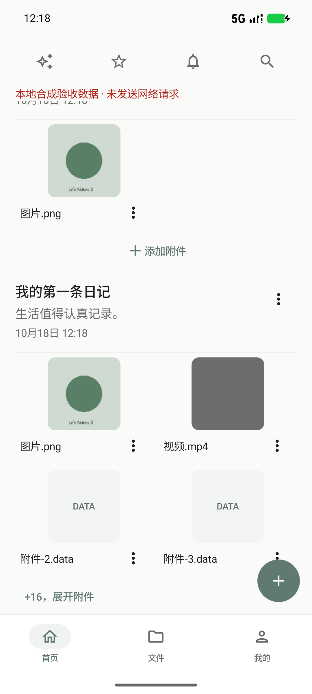
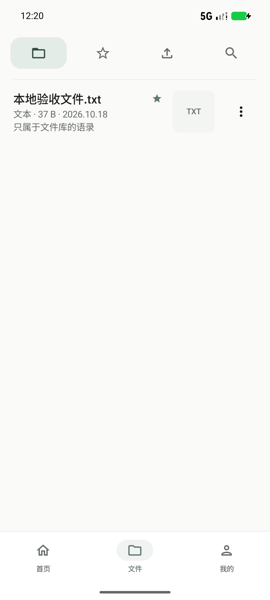
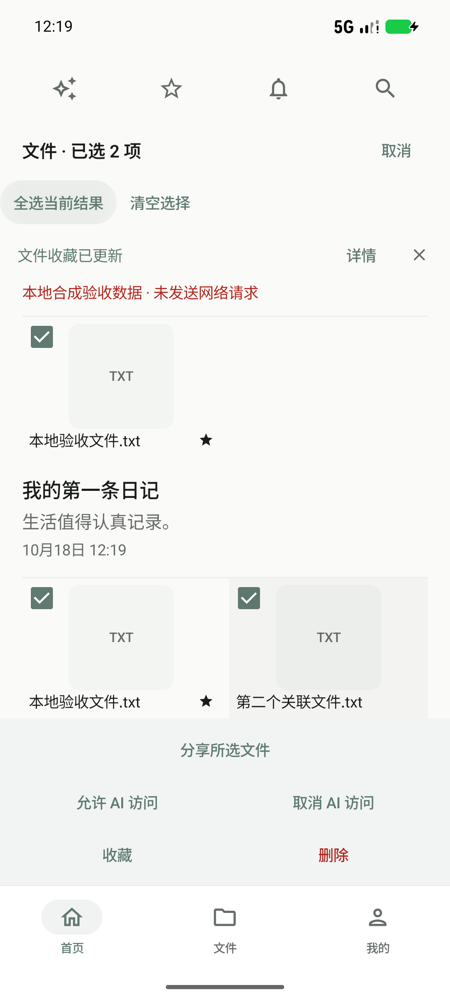

# 人生随记 Life Notes

**你的私人数字生活档案**

Android 本地优先的个人数字生活档案应用：记录生活、整理文件、加密保存，并由你决定外部 AI 可以接触哪些内容。

**当前开发版本 V1.4（1.4.0 / code 7），统一候选已完成工程验证，真实 ARM64 手机 UAT 待完成。V1.4 尚未正式发布。** 现有 [v1.0.0 正式 Release](https://github.com/yezw909-source/life-notes-android/releases/tag/v1.0.0) 保留供历史版本下载，不能将其视为 V1.4 安装包。

本产品由个人独立开发。本仓库用于产品展示、使用说明与版本分发，**不提供应用源码，也不代表产品已开源**；源码与内部开发历史另行私有保存。

## 实际完成的能力

| 领域 | 已实现 | 主要边界 |
| --- | --- | --- |
| 记录与整理 | 日记/项目笔记、标签、收藏、搜索、提醒、回收站；长按多选、左滑及批量管理 | 项目笔记属于记录体系；回收站不能代替备份 |
| 关联附件 | 首页前四项缩略图网格、数量入口、有界展开、新增/关联已有文件、解除当前关系 | 共享附件不因解除某条记录关系而误删 |
| 文件中心 | 系统选择器批量导入、收藏、搜索、分类、软删除/恢复、批量管理、重命名和导出 | APK/压缩包/未知文件原样保存，不执行、安装或解包 |
| 预览 | 图片、PDF、文本/部分 Office 文档、本地音视频；按打开来源跨格式切换 | 编码及解析能力有界，不保证任意文件均可预览 |
| 视频 | 长按临时 2x、双击 ±10 秒、倍速、缩放/平移、适应/填充、来源内切换；大型 MP4 按需代表帧 | 旧 Vault V1 首次读取仍需完整认证；取帧不是播放首帧指标 |
| PDF | 多页翻页/跳页、缩放、当前视口高清裁片、有界缓存、旋转阅读位置保持 | 原文件图像像素不足无法补回；并非所有文档均测得提速 |
| 录音 | 主动开始、后台/锁屏前台服务、暂停试听、试听后续录、停止加密保存 | 电话/抢麦克风、强杀及 OEM 策略需实体设备验证 |
| 系统文件互通 | ACTION_VIEW 临时预览及主动导入；文本/TXT/Markdown、单/多文件分享；只读 DocumentsProvider | 主动选择与受控 URI；不授予全库写入权限，不能确认接收方最终保存 |
| 回收站期限 | 默认永不自动清理；1/7/30/自定义 1–3650 天、到期预估与独立确认 | 复查当前引用；未知删除时间保留；系统可延迟调度；恢复备份后执行关闭 |
| 备份恢复 | 可选密码及独立密码显隐、流式读写、项数/字节进度、目标读回校验、历史有效备份导入 | 无密码备份可被他人读取；超过 4GiB 极限与所有第三方 Provider 尚未全面验收 |
| AI | 自配服务商、单模型/并行咨询/有限圆桌、本地会话与跨模型连续性、授权目录发现及有界文档读取/引用 | 外部联网模型；无默认全库上传、OCR 或图片/音视频内容理解，也不自动改写档案 |
| 随心一卦 | 现有输入起卦、卦象/动爻/变卦与记录 | 用于个人记录与思考，不作专业决策保证 |

## 产品画面

以下是 V1.4 隔离模拟器中的原始 Debug 截图，内容为合成演示资料，不是 ARM64 Release 真机证据。红色合成数据提示仅存在于调试验收环境；未裁剪或美化。期限弹窗为组件专项场景。见 [截图来源](screenshots/README.md)。

| 首页关联附件 | 文件中心 | 文件多选 |
| --- | --- | --- |
|  |  |  |

## 技术架构与隐私

Kotlin / Jetpack Compose / Material3，MVVM 与单向状态流、Coroutines/Flow；Room + SQLCipher 本地数据库，Android Keystore 保护密钥与凭据，持久附件使用 Vault 加密。V1 读取保留完整认证，V2 保留现有分块认证随机访问。Media3 处理本地播放，Android PdfRenderer 与有界裁片处理 PDF；系统 SAF 和只读 DocumentsProvider 处理用户主动文件互通。

本地记录与文件管理不依赖产品账号或云档案服务器。系统云备份关闭，主动便携备份支持可选密码；无密码导出内容可能被他人读取。预览/录音草稿可使用受控私有明文缓存，按生命周期清理；加密不保护已经交给外部应用的副本。详见 [隐私说明](PRIVACY.md)。

## AI 交互层

AI 是可选的外部服务交互层，支持 OpenAI、Anthropic、Gemini、DeepSeek 与兼容接口的现有适配。用户自行配置凭据及模型；凭据由设备密钥保护，不随便携备份迁移。聊天输入会发送给所选服务商，真实服务商、计费及其数据政策需分别核对。

档案默认拒绝访问；ALLOW / ASK / DENY、内容范围、接收方及发送前重新校验共同控制出站。目录元信息与文件正文分开授权，切换接收方不继承其他服务商的临时许可，来自档案的历史回答也保留来源依赖。多 AI 不扩大权限。

文本、DOCX/XLSX/PPTX 只提取受限文本；不执行宏或重新计算公式。PDF 嵌入文本提取依赖 API 35+；API 26–34 的 AI PDF 路径仅提供元信息。扫描件无 OCR，图片/音视频为元信息；目录可发现不等于可以理解内容。没有自动档案写入、后台自主代理、默认云同步或离线大模型。

## 构建、安装与验证

源码不在本公开展示仓库，不能通过克隆本仓库构建 APK。内部工程使用 Kotlin、JDK 21、Gradle 9.6.0 / AGP 9.4.0 与 SDK 37；最低 Android 8.0 / API 26，分发候选为 ARM64、R8、非 Debuggable 构建。完整运行/签名构建说明随私有源码维护。

[安装与版本渠道](INSTALL.md) · [更新日志](CHANGELOG.md) · [V1.4 候选说明](RELEASE_NOTES.md) · [功能边界](FEATURES.md) · [验收摘要与性能](PERFORMANCE.md) · [已知限制](KNOWN_LIMITATIONS.md) · [真机 UAT](UAT.md) · [第三方声明](THIRD_PARTY_NOTICES.md)

V1.4 开发记录：481 项 JVM、布局收尾前候选 73 项回归；最终两处按钮布局调整后 10 项专项及 API30 11 项分进程复测。模拟器性能不能替代手机结论，已有 PDF 样本存在界面延迟回退，具体数字与样本边界如实披露。

后续优先完成真实设备安装升级、录音/媒体/分享兼容与大文件体验验收。跨应用拖放与悬浮文件托盘仍为研究，不是已上线能力。不公布真实档案、凭据、内部日志或未经验证的用户量/服务商成绩。
