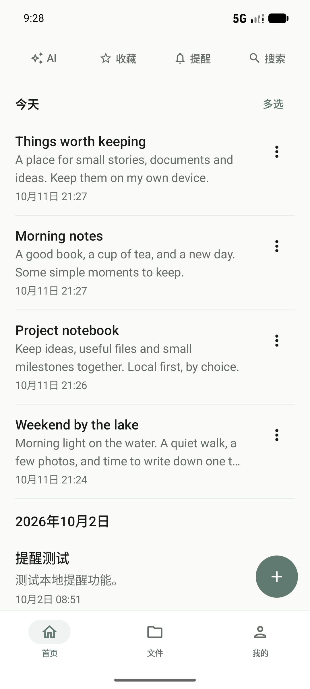
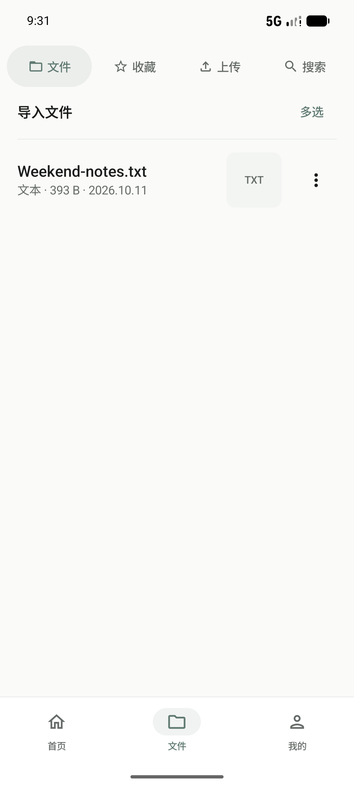
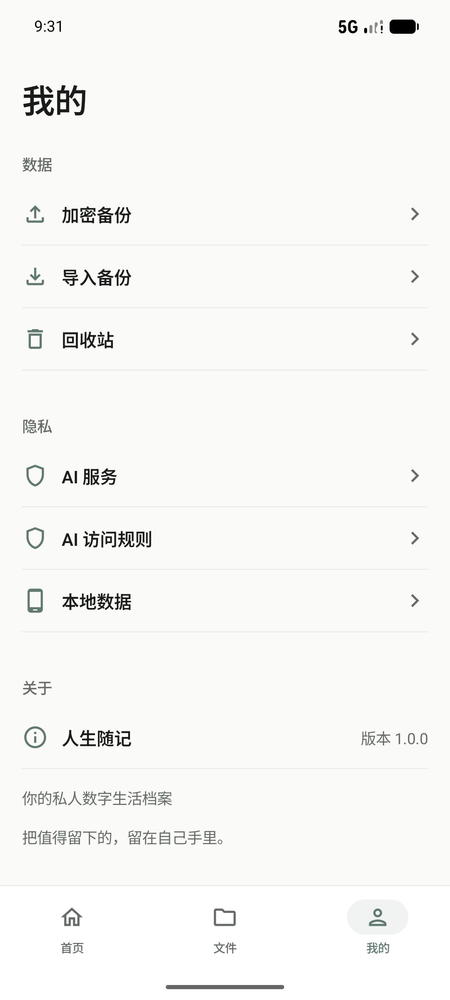

# 人生随记 · Life Notes

**你的私人数字生活档案**

把值得留下的，留在自己手里。

人生随记是一款 Android 本地优先的个人数字生活档案应用：记录生活、整理文件，用加密存储保护档案，并由你决定 AI 可以接触哪些内容。

本产品由个人独立开发。本仓库仅用于产品展示、使用说明与版本分发，**不提供应用源代码，也不代表产品已开源**。完整源码与内部开发历史另行私有保存。

> 当前状态：Android 1.0.0 已获产品负责人发布批准，正在完成最后上线检查。同字节 ARM64 签名 RC1 的最小真机冒烟已由产品负责人确认通过；更广的设备兼容性和真实 AI 服务仍未完整验收。APK 尚未上传，请以 [官方 Releases](https://github.com/yezw909-source/life-notes-android/releases) 实际发布的资产为准。

## 你可以做什么

- 写日记与个人记录，用标签、收藏、搜索与回收站整理内容；首页记录与导入文件独立管理，支持批量操作。
- 建立私人文件库，查看图片、文档，播放本地音视频；具体可预览格式取决于文件与系统支持。
- 主动开始录音，在后台或锁屏时继续录制；停止后加密保存。系统前台服务提供通知与停止操作。
- 设置本地提醒，目标时间对齐整分钟；通知、精确排程与横幅遵守系统权限及用户设置。
- 使用「随心一卦」，查看卦象、动爻与变卦，作为个人记录与自我思考的辅助，不代替专业决策。
- 使用本地加密 Vault，以及密码保护的便携备份与恢复，无需产品账号或自建服务器。
- 自行配置 OpenAI、DeepSeek、Gemini 等现有服务商。支持单模型、并行咨询与圆桌迭代，同一会话跨模型继续讨论，退出或重启后保留本地历史。
- 在授权范围内让 AI 发现文件目录，按能力读取有限文档文本、回答并引用来源；目录可发现不等于文件内容一定可解析。

## 由你控制 AI 的访问范围

AI 默认拒绝访问私人档案。ALLOW、ASK、DENY 与有效授权共同限制记录及文件的访问；ALLOW 不是自动全库上传。发送档案前展示接收方和实际范围，ASK 只在批准的内容、请求与接收方范围内有效。

切换服务商保留会话，但不会继承其他接收方的临时档案授权；带来源的历史回答也重新检查权限。聊天请求与你输入的内容本身会发送给所选服务商。没有凭据时，不会在正式包中生成模拟回答。

详细说明：[隐私](PRIVACY.md) · [功能边界](FEATURES.md) · [已知限制](KNOWN_LIMITATIONS.md)

## 产品画面

截图使用专用验收环境中的演示内容，不含真实私人档案。原始设备画面未美化；具体来源见 [截图说明](screenshots/README.md)。

| 首页时间线 | 文件中心 | 我的 |
| --- | --- | --- |
|  |  |  |

## 本地优先的架构

Kotlin / Jetpack Compose 构建 Android 界面，采用 MVVM 与单向数据流。持久层使用 Room + SQLCipher，文件在加密 Vault 中保存；密钥使用 Android Keystore 保护。便携加密备份用于用户主动迁移数据，而不是依赖系统云备份。

AI 网络适配与本地档案权限网关分离。会话历史本地持久化，对每个接收方检查授权、来源依赖和上下文预算。没有产品账号依赖，也没有默认的产品云同步服务器。

这是架构概览，不公开具体实现源码、内部日志或敏感配置。第三方组件仍遵守各自许可证，见 [第三方声明](THIRD_PARTY_NOTICES.md)。

## 安装与版本

分发目标为 Android 8.0（API 26）及以上 ARM64 签名 APK。其他 Android 版本/OEM 的实际验证范围见已知限制。

[安装说明](INSTALL.md) · [更新日志](CHANGELOG.md) · [待发布说明](RELEASE_NOTES.md) · [真机验收](UAT.md)

后续优先收口兼容性、真实 AI 服务验证和大文件库性能；更新计划不表示相关问题已解决或承诺交付日期。问题反馈时请勿附 API Key、备份密码或私人档案。
