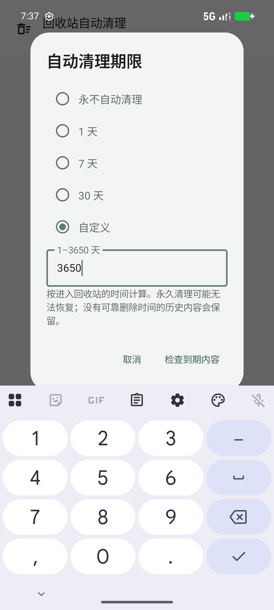

# V1.4 公开可复核截图

以下四张为实际 API37 / x86_64 隔离模拟器 Debug 原图，使用合成演示数据；已逐图检查，不含个人档案、凭据或第三方影视/作品集画面，未裁剪/美化。不能当作 ARM64 Release 真机证据。红色合成数据提示为调试验收环境专有，正式 Alpha 不显示。自动清理图来自组件专项，不能当作生产完整导航截图。

首页、文件、多选取自最终布局候选，App SHA256 为 40db614972e10f0a54190423378d9f2281df7ae4a91aedf94e73ad1640e62c25；期限弹窗取自布局调整前统一候选 b96c79427d3ee993ba8bc0a3c0e39a986ac9c524175822b240b7837307233c34，相关组件未变。各图片校验值见同目录校验清单。

| 图片 | 来源与说明 |
| --- | --- |
| v1.4-home.png | 首页附件前四项及数量入口；原始取样滚动位置保留 |
| v1.4-files.png | 文件中心，合成 37B 文本条目 |
| v1.4-selection.png | 首页文件多选，明确计数与临时操作栏 |
| v1.4-retention.png | 自定义期限组件专项，默认关闭需独立确认 |

本地完整交付还保留收藏、搜索、预览、分享、取帧和失败复测等原始证据；未将用户作品集、长视频和原始设备数据上传 Git。公开展示仓库中的旧 home.png/files.png/settings.png 是 V1.0 历史画面，不能作为 V1.4 截图。
